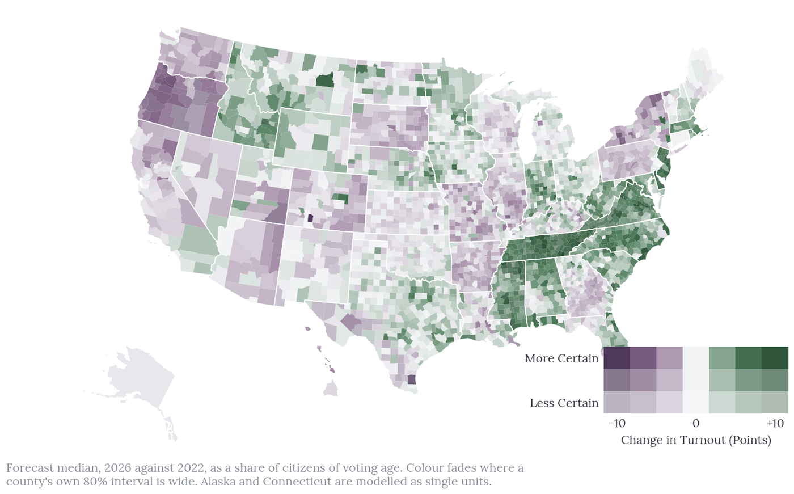
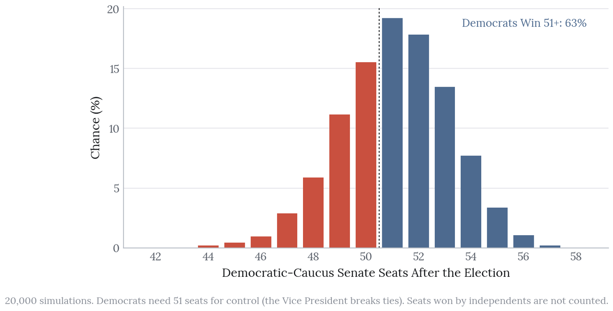
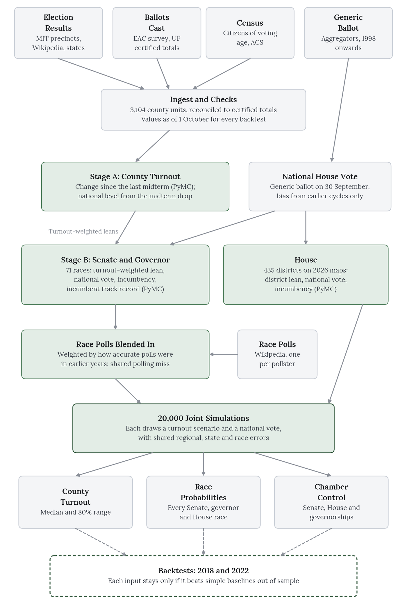
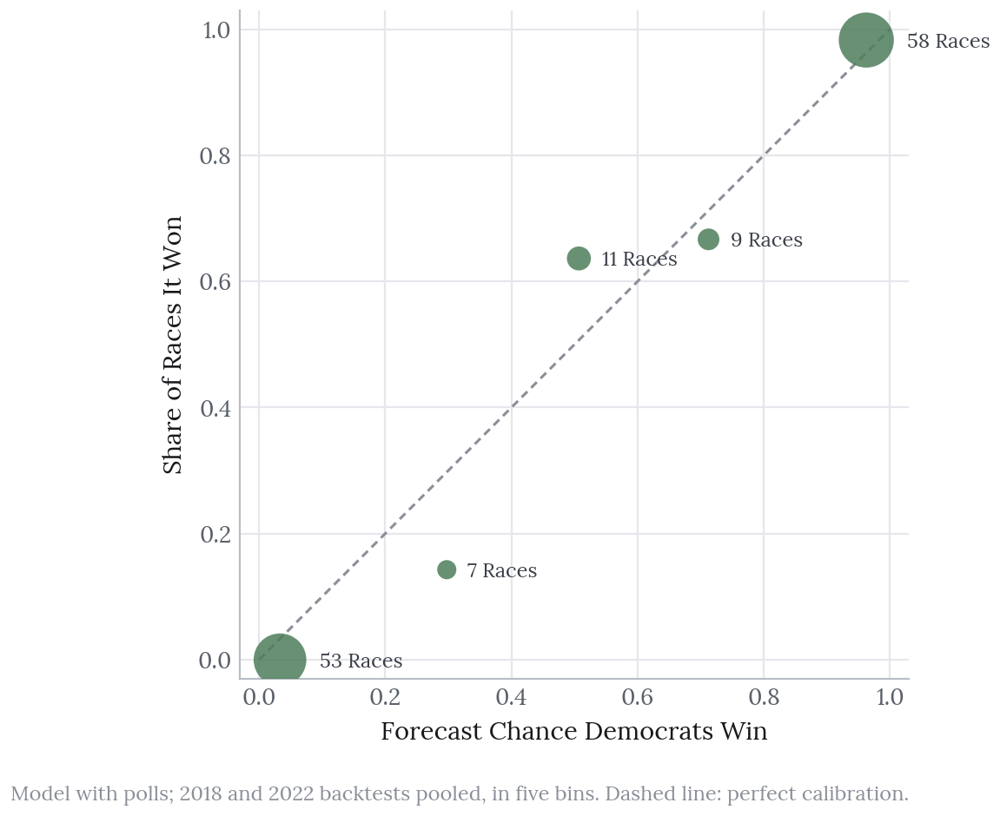

# 2026 Midterms Forecast

A transparent, pre-registered forecast of the 3 November 2026 US midterms, built entirely from public data. Most forecasts begin with who wins; this one begins with **turnout**, estimated for every county, and builds the vote share for every Senate, governor and House race on top of it.

**[Interactive forecast and results](https://oliviajacksonlambert.com/midterms-2026/)** · **[Full write-up: method, backtests and limits](https://oliviajacksonlambert.com/work/turnout-first-2026/)** · **[The provisional scorecard](https://oliviajacksonlambert.com/work/scorecard-2026/)** · **[Forecast v1 tables](forecasts/v1/)**



## Forecast v1 at a Glance

Released 22 October 2026 as the tagged commit [`v1`](../../tree/v1), with 20,000 simulations of the whole election. This is the version that will be scored against the results.

| | Forecast |
|---|---|
| **Turnout** | 47.9% of adult citizens (80% range 42.2% to 53.5%), against 46.5% in 2022 |
| **Senate** | Democrats win control in 63% of simulations, Republicans in 33% |
| **House** | Democrats win a majority in 93%, with a median of 234 seats |
| **Governors** | Democrats win a majority of governorships in 62%, Republicans in 22% |



## How It Works

Two stages, each backtested on the 2018 and 2022 midterms using only data that would have been available a month before each election:

1. **Turnout (county).** The change from the last midterm, driven by presidential surge, whether a Senate race is on the ballot, the out-party effect, demographics and state effects, with the national level set by the historical midterm drop.
2. **Vote share (race).** State partisan lean weighted by the expected electorate, national swing from the generic ballot, incumbency and race polling, with correlated national and regional errors so that the races move together in simulation as they do in real elections.

To count as a forecast, each stage had to beat a simple baseline in the backtests: "the same as last midterm" for turnout and "the last presidential lean" for vote share. Features that did not improve the backtests, such as fundraising, were tested and left out; the write-up lists them.



## Scoring

Every forecast is published before the election and scored after it, misses included. The scoring plan (turnout error and interval coverage; Brier score, log loss and calibration for the races; where the actual seat totals land in each distribution) is tracked in [the scoring epic](../../issues/23).



## Principles

- **Public data only**: election returns, census estimates, polls and filings, all listed below.
- **Pre-registered**: the forecast is a tagged commit with a manifest of input dates and file hashes, so it cannot change after the fact.
- **Nonpartisan**: the aim is calibration, not advocacy.

## Reproducing It

See `PLAN.md` for the original plan, timeline and data sources.

### Setup

```
pip install -r requirements.txt
```

No download forms are needed, and the only key is an optional free [api.data.gov](https://api.data.gov/signup/) key (`FEC_API_KEY`), used solely to rerun the fundraising test that was left out of the model. The ingest pulls public files from GitHub
(MIT Election Lab's county returns and a county results mirror) and from www2.census.gov
(CVAP, ACS summary files, Gazetteer), the EAC (EAVS), the UF Election Lab, FiveThirtyEight's
data repo and Wikipedia. The first run downloads about 800 MB and caches what it needs in
`data/raw/`, which is never committed.

### Run

One command runs everything, in the order below (each step caches what it downloads, and
the model fits take about an hour):

```
cd src
python -m forecast.pipeline                    # add --refresh for new 2026 data, --skip-backtests to leave out the backtest
python -m forecast.release v1 --draft          # forecast tables to forecasts/_draft/v1/, for checking
python -m forecast.release v1                  # the same to forecasts/v1/, ready to commit and tag
```

`--refresh` is passed on to `races`, `generic_ballot`, `polls` and `house`. `--skip-backtests` only works if
a backtest has been run before, because the 2026 models read the leans it saved. The
pipeline does not add `--refresh` for you: on release day, pass it. `--dry-run` prints the
steps without running them. A release refuses to overwrite a published folder.

The steps one at a time:

```
cd src
python -m forecast.ingest            # presidential county panel, 2008-2024
python -m forecast.races             # races, incumbents, nominees and results (add --refresh for 2026)
python -m forecast.midterms          # midterm county turnout 2014-2022 and 2018/2022 county results
python -m forecast.generic_ballot    # generic ballot as of 30 September and House vote (add --refresh)
python -m forecast.polls             # race polls from Wikipedia and their averages (add --refresh)
python -m forecast.backtest          # turnout, race and House backtests, 2018 and 2022
python -m forecast.turnout_model     # 2026 county turnout (Stage A)
python -m forecast.vote_model        # 2026 Senate and governor races (Stage B)
python -m forecast.house             # 2026 House: 435 districts and the seat distribution (add --refresh)
cd .. && python figures/make_figures.py   # figures in figures/out/
python -m pytest                     # data and model checks
```

`forecast.races` runs before `forecast.midterms` because MIT's party labels are wrong for
some nominees, and the parsed nominee names correct them. The backtests run before the 2026
models because Stage A saves the turnout-weighted leans Stage B needs (`lean_draws_*.parquet`).

`county_panel.parquet` has one row per county unit and presidential year (2008 to 2024):
Democratic, Republican and total votes, two-party share, citizen voting-age population,
turnout as a share of it, and ACS 2020–2024 demographics. `PLAN.md` explains the county
units and known limits.

### Data Folder

Downloaded and processed data live in `data.nosync/`, with `data` as a symlink to it, so that cloud-synced folders (which skip anything ending in `.nosync`) never evict them. In a fresh clone:

```
mkdir -p data.nosync/raw data.nosync/processed && ln -s data.nosync data
```

To keep data somewhere else entirely, set `TURNOUT_DATA=/path/to/data`.

## Licence

The code is released under the [MIT Licence](LICENSE). The data it downloads remain under their sources' own terms.
